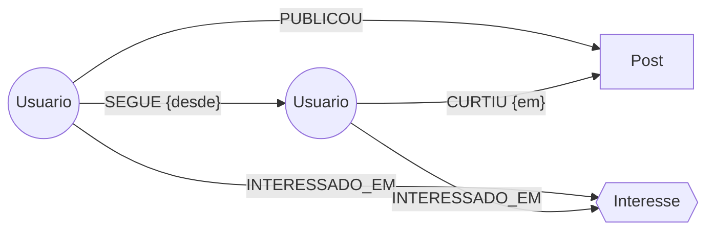

# Modelagem do grafo — Rede Social

Modelo de **grafo de propriedades** (property graph) do Neo4j: nós com rótulos e propriedades,
relacionamentos com tipo, direção e propriedades.

## Nós

| Rótulo | Propriedades | Restrição |
|---|---|---|
| `Usuario` | `username`, `nome`, `cidade`, `bio`, `criadoEm`, `atualizadoEm` | `username` único |
| `Post` | `id` (UUID), `conteudo`, `criadoEm`, `editadoEm` | `id` único |
| `Interesse` | `nome` | `nome` único |

## Relacionamentos

| Tipo | De → Para | Propriedades | Significado |
|---|---|---|---|
| `SEGUE` | Usuario → Usuario | `desde` | rede de conexões (direcionada, como Instagram/X) |
| `PUBLICOU` | Usuario → Post | — | autoria |
| `CURTIU` | Usuario → Post | `em` | engajamento |
| `INTERESSADO_EM` | Usuario → Interesse | — | base para recomendação |

## Por que grafo aqui

- **Sugestão de quem seguir** = percorrer 2 saltos `(eu)-[:SEGUE]->()-[:SEGUE]->(sugestao)`.
  No relacional seriam *self-JOINs* na tabela de seguidores, cada vez mais caros a cada nível.
- **Graus de separação** = `shortestPath` nativo, sem SQL recursivo.
- **Feed** = vizinhança direta do usuário; o custo depende de quantos amigos ele tem,
  não do tamanho total da base (*index-free adjacency*).
- Novos tipos de relação (ex.: `BLOQUEOU`, `COMENTOU`) entram sem migração de esquema.
